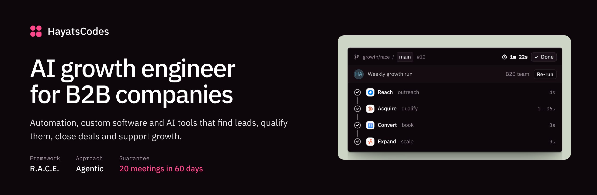

 

👋 Hi, I'm Hayats. Nearly five years of building software for startups, two of them taken from idea to product-market fit. Once the product worked, growth was the bottleneck, and growth is full of repeat steps. Developers automate repeat steps, so I moved into GTM engineering.

📬 The last three months I've spent sending email at scale myself, which is how I learned what breaks first and what's worth building.

> 🤝 **Guarantee:** 20 qualified meetings in 60 days, or I keep working for free.

## 🏁 How I work: R.A.C.E.

  

👇 Click a stage to open it.

<b>🎯 Reach</b>: find the right people and get in front of them

 

- 🔎 Lead sourcing and enrichment from the right data for the audience
- ✅ Every email verified before it goes near a campaign
- 📨 Sending from warmed domains and inboxes, with messages tested before they scale
- 🧰 **Tools:** Monid · Apify · Apollo · Clay · Hunter · Vayne · DataForSEO · Instantly

<b>🧠 Acquire</b>: turn a list into qualified leads

 

- 🕵️ An AI agent researches each company and reads what it actually does
- 🎚️ Leads are scored against the ideal customer, so effort goes where it pays
- ✍️ The opener and the reply are drafted from that research
- 🧰 **Tools:** Claude · Claude Code · ChatGPT · Codex · Cursor

<b>📅 Convert</b>: answer fast and get the meeting held

 

- 🔔 Reply alerts reach the team's phones in minutes
- 🏷️ Every reply is tagged and scored, with a ready answer for each kind
- 🗓️ Booking, confirmation and reminders, so booked meetings turn into held ones
- 🧰 **Tools:** Instantly · Google Calendar · n8n · Make

<b>🌱 Expand</b>: keep what works and grow it

 

- 🗂️ Leads, replies and meetings synced into the CRM
- 🔁 Follow-up and nurture for people who aren't ready yet
- 🚀 The next campaign is built from what worked in the last one
- 🧰 **Tools:** HubSpot · Origami · n8n

## 🗓️ The 60 days

<b>1️⃣ Set up</b>

 

Domains, inboxes and tracking, plus the first verified lead list.

<b>2️⃣ Build</b>

 

The research agent, the offer and the first campaign.

<b>3️⃣ Launch</b>

 

Sending, reply alerts and same-day calls with interested prospects.

<b>4️⃣ Optimize and scale</b>

 

Keep what books meetings, cut what doesn't, and send more.

## 🛠️ What I've built

- 🧭 **Leads and campaign planner:** turns an ideal customer profile into a lead list and a campaign plan.
- 🤖 **Lead research agent:** reads each company, scores it against the profile and drafts the opener.
- 🔌 **Lead sourcing system:** finds and verifies the right people at the right companies.

> 🔒 These live in private repositories. The workflows I give away are below.

## 🧩 Claude Code workflows you can copy

Skills I use in my own campaigns. Copy one into `.claude/skills/` and run it.

<b>📰 Google News RSS monitoring</b>

 

Turns funding, hiring and launch news into a fresh, import-ready prospect list. Pulls only stories not seen before, extracts the companies, checks them against the CRM and drafts the campaign. Does not send email.

<b>⚡ Fast reply system</b>

 

Alerts, tags and ready answers so interested prospects hear back in minutes and get a warm call the same day. Drafts only.

<b>🙋 Meeting show-up workflow</b>

 

Confirmations, reminders and follow-up that turn booked meetings into held ones, with a way to see where meetings leak. Drafts only.

<b>🧪 Claude and Monid data workflow</b>

 

Finds a data source, tests a sample, checks accuracy and scales under a budget cap, then reports the real cost.

👉 **[Get the skills at hayatscodes.com/workflows](https://hayatscodes.com/workflows)**

## 🧰 Tools I use

| | | |
|---|---|---|
| 🔎 | **Find and enrich** | Monid · Apify · Apollo · Clay · Hunter · Vayne · DataForSEO |
| 🧠 | **Think and automate** | Claude · Claude Code · ChatGPT · Codex · Cursor · n8n · Make |
| 📨 | **Send and track** | Instantly · Origami · HubSpot |
| 💻 | **Build** | TypeScript · Node.js · React · Next.js · Python |

## ✍️ Writing

- 📖 [GTM Engineering With Claude: A Beginner's Guide for B2B Teams](https://hayatscodes.hashnode.dev/gtm-engineering-with-claude-a-beginner-s-guide-for-b2b-teams): how B2B teams can use Claude Code for lead lists, email verification, outreach and booked meetings.

More on the [blog](https://hayatscodes.hashnode.dev).

## 📞 Work with me

If your pipeline depends on cold outbound and you want it built, measured and guaranteed, [book a call](https://cal.eu/hayatscodes-studio/discovery) or write to [hayatscodes@gmail.com](mailto:hayatscodes@gmail.com).
